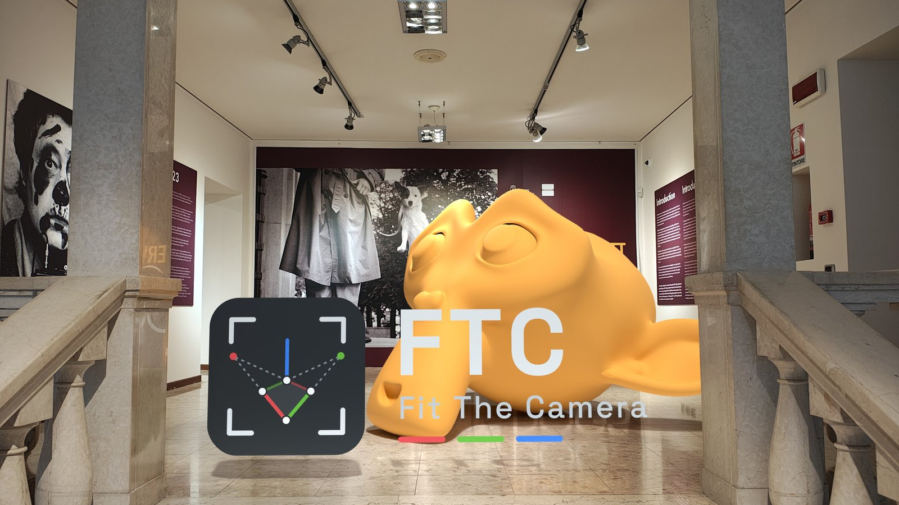
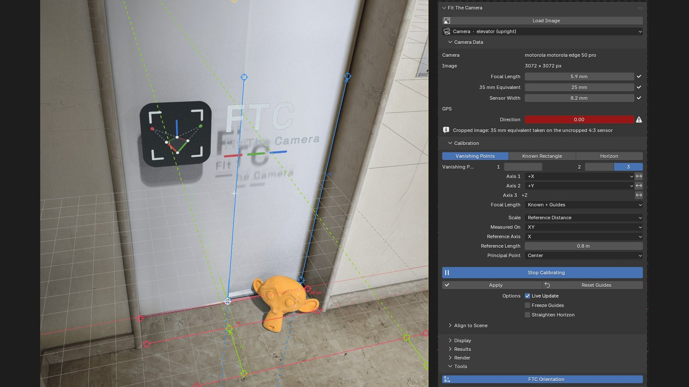
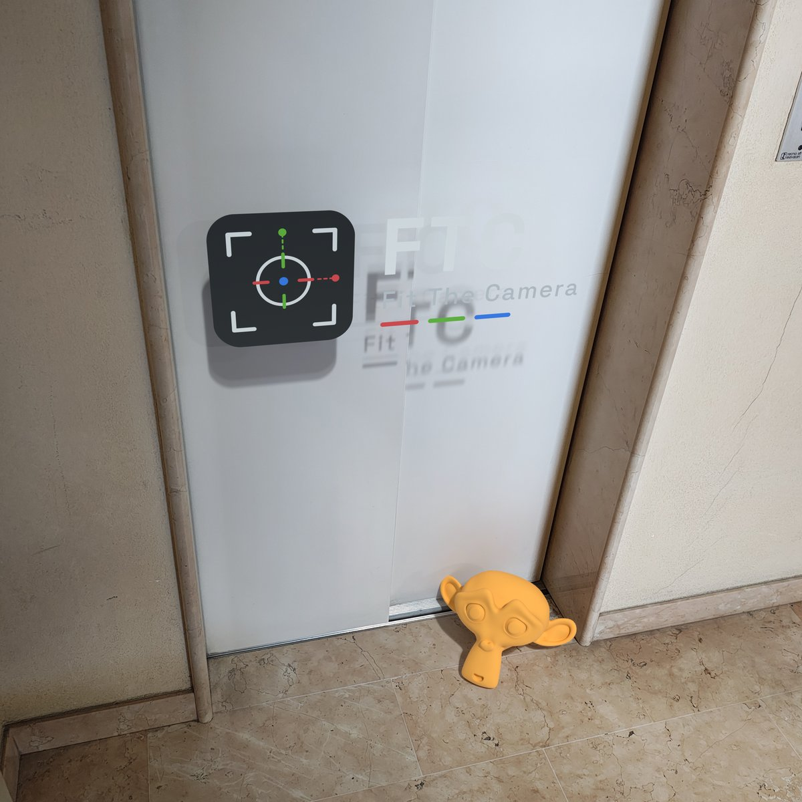
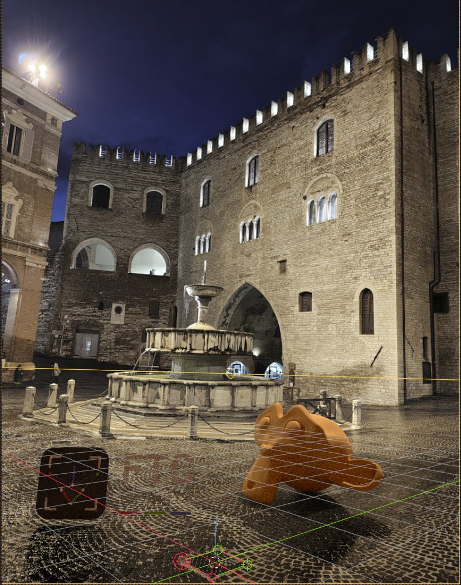
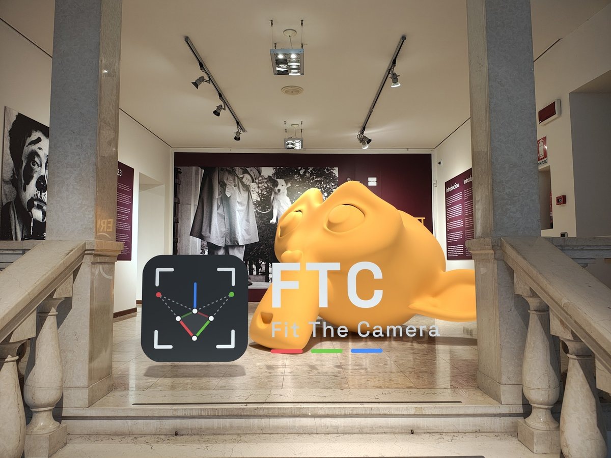

# FTC – Fit The Camera

**English** · [Italiano](README.it.md)

**Get it on [Blender Extensions](https://extensions.blender.org/add-ons/fit-the-camera/)** (or from the
[Releases](https://github.com/Tonysa87/FTC-Fit-The-Camera/releases)).

A Blender 5.2+ extension that matches a camera to a single image (a photo, a
render, a drawing). From a few lines drawn over the image it finds the focal
length, the position and the rotation of the camera, at real-world scale. It can
then set up the scene to render 3D objects over the photo, with their shadows on
the real ground.

## Quick start

1. **Install** – in Blender *Edit › Preferences › Get Extensions*, search
   "Fit The Camera" and press *Install* (page on
   [Blender Extensions](https://extensions.blender.org/add-ons/fit-the-camera/)).
2. **Load the photo** – 3D viewport sidebar (**N**) › **FTC** tab › **Load
   Image**. The photo goes onto the scene camera (onto a new camera named after
   the photo when that one already has a photo) and the view looks through it;
   focal length and sensor come from the EXIF data (check them in *Camera
   Data*).
3. **Draw the guides** – keep *Vanishing Points* with 2 groups and press
   **Calibrate**. Drag the two **red** guides (X) onto two edges that run the
   same way in reality – floor tiles, a skirting board, the bottom of a door –
   and the two **green** guides (Y) onto two edges at right angles to them, on
   the floor too. Put the white origin handle on the floor where you want the
   scene's centre. Hold **Shift** to move finely with a ×4 magnifier.
4. **Set the scale** – drag the two *Reference Distance* handles onto the ends
   of something whose length you know (a door width, a tile) and type it in
   *Reference Length*.
5. **Apply** – press **Enter**: the camera is placed. *Results* shows the focal
   length, the camera height and how far the guides can be trusted.
6. **Render over the photo** – model your object, add a plane on the real floor
   and give it the *Shadow Catcher* role (*Render › Object Roles*), press
   **Prepare Render**, then render (F12): the object is in the photo with its
   shadow.

<table>
  <tr>
    <td width="33%"></td>
    <td width="33%"></td>
    <td width="33%"></td>
  </tr>
  <tr>
    <td>The result: a CG object with its shadow on the real floor (shadow catcher)</td>
    <td>The calibrated camera in the viewport: horizon, grid and origin</td>
    <td>A CG object in a gallery photo, at real-world scale</td>
  </tr>
</table>

The rest of this page explains every option.

## Features

- **Vanishing points**: 1, 2 or 3, two to six guide lines per axis (six: 1.1, in development), with the axis and
  direction of each group (X, Y, Z, ±).
- **Known rectangle**: the four corners of a rectangle of known size, lying on the reference plane (XY, XZ or YZ).
- **Horizon**: the horizon line, the camera height and the heading.
- **EXIF**: camera, lens, focal length, 35 mm equivalent, sensor size, GPS and
  compass direction are read from the image. The known focal length can be refined
  by the guides, or the guides can solve it on their own.
- **Real scale** from a reference distance (a known length in the image) or a
  *scale cube* of known size.
- **Uncertainty and guide fit**: how far the result can be trusted, with warnings
  for lines that are not really parallel, a wrong EXIF focal length, a vanishing
  point too far away.
- **Magnifier on the handles**: hold Shift while dragging a handle to open a ×4
  lens centred on it; the photo slides underneath and the handle moves finely,
  for pixel-precise placement on edges and corners.
- **One camera per photo**: each photo can get its own camera, named after it;
  the panel switches between the calibrated cameras.
- **Align to the scene**: put the calibrated floor or wall on the 3D cursor, a
  face or an object.
- **FTC transform orientation**: the photo's axes for Blender's own move, rotate
  and scale tools and snapping, also after aligning the photo to the scene.
- **Render over the photo**: one button sets colour management, transparent film
  and the compositor; shadow catcher and holdout roles for the objects that
  stand in for real surfaces and objects of the photo.
- **Calibration report** (1.1, in development): Markdown or JSON, with the
  source of every input.
- **Fit Sun** (1.1, in development): a Sun light turned like the sun of the
  photo, from the EXIF date, time and GPS (or entered by hand), placed by the
  compass, by the scene axis it comes from (turned by eye) or by a shadow; or
  measured on a shadow in the photo alone. **Fit HDRI** turns the World HDRI about Z onto
  that sun.
- Interface in English and Italian.

## Install

FTC is on [Blender Extensions](https://extensions.blender.org/add-ons/fit-the-camera/): in Blender 5.2 or later open
*Edit › Preferences › Get Extensions*, search "Fit The Camera" and press
*Install*. Blender then offers the updates there.

Without the online extensions (offline, or a specific version):

1. Download `fit_the_camera-<version>.zip` from the
   [Releases](https://github.com/Tonysa87/FTC-Fit-The-Camera/releases).
2. In Blender 5.2 or later: *Edit › Preferences › Get Extensions › ⌄ ›
   Install from Disk…* and pick the zip.

The extension only reads the image file you load (and its EXIF metadata) and,
from 1.1, writes the calibration reports you export. It does not use the
network. Reports contain the latitude and longitude of the shot only when Fit Sun
is used.

## The panel, step by step

Open the sidebar of the 3D viewport (N) and the **FTC** tab.

1. **Load Image** – in the file browser's side panel choose the **Camera**: a
   new one (named after the photo with *Name After Photo*, on by default) or a
   camera of the scene, whose photo is replaced. It proposes the camera in view
   while it has no photo yet, otherwise a new one. Then it sets the image as the
   camera's background, matches the render resolution, reads the EXIF data and
   looks through the camera. With several calibrated cameras, the camera name in
   the panel is a menu to switch between them. Photos stored rotated (EXIF
   orientation) get an upright copy with **Make Upright Copy**.
2. **Camera Data** – check or enter the focal length and the sensor width (or the
   35 mm equivalent). Every field shows whether it comes from EXIF, is missing
   (red) or was typed in.
3. **Calibration** – pick a mode and press **Calibrate**: drag the handles of the
   guides onto edges of the image that are parallel in the real world.
   Shift = fine, with a ×4 magnifier on the handle, Ctrl = snap, 1/2/3 = axis,
   F = flip the direction, H = straighten the horizon, Ctrl+Z / Ctrl+Shift+Z = undo / redo, Enter = apply,
   Esc / right click = exit. The **− n +** buttons next to an axis (1.1, in development) add a
   guide line between its first two, up to six, or remove the last: more lines
   on long edges average out the placement errors. With *Live Update* (default) the camera follows the
   guides while you drag; Enter or **Apply** writes it and ends the session.
   Outside a session, changes made in the panel move the camera only on
   **Apply**. In the camera view the photo moves with the camera: to see the
   result, look at the scene objects or at the camera's location.
4. **Align to Scene** – place the calibrated plane (XY, XZ or YZ) on the 3D
   cursor, on the active face (Edit Mode) or on the active object.
5. **Results** – focal length, field of view, camera height, angles, uncertainty
   and guide fit, with warnings. **Export Report** (1.1, in development) saves them, with the
   source of every input and the sun, as Markdown or JSON.
6. **Render** – see below.
7. **Fit Sun** (1.1, in development) – a Sun light and the World HDRI turned
   like the sun of the photo: see below.
8. **Tools › FTC Orientation** – makes the "FTC" transform orientation the viewport's:
     the photo's calibrated axes in the scene (created on Apply and by Align to
     Scene). Blender's gizmo, G/R/S with X/Y/Z and snapping then follow the photo
     also after aligning it to a face or the cursor. Click again for Global.

| Mode | Input | Notes |
| --- | --- | --- |
| 1 vanishing point | 2–6 guides for axis 1 + a line along axis 2 | needs the focal length |
| 2 vanishing points | 2–6 guides per axis | optional *Third Axis Line* |
| 3 vanishing points | 2–6 guides per axis | principal point at the centre, by hand or solved |
| Known rectangle | 4 corners, real length of the two sides | on XY, XZ or YZ |
| Horizon | horizon line, camera height, heading | needs the focal length |

### Scale cube

A wireframe cube of known size (10 cm to 10 m, or custom) standing on the
reference plane. Put the base handle at the foot of something of known height and
drag the top handle up to its top: the scale of the scene follows. The cube and
the *Reference Distance* exclude each other: only the one chosen in the *Scale*
menu is shown (new photos start with the reference distance). With a known
rectangle or the horizon the scale is already known and the cube is an optional
visual check, off by default (*Display* › *Scale Cube*, with its size). Dragging
the base or the origin never flips the cube: it extends the way the camera looks
(on a wall: upwards).

### Reference distance

Two handles at the ends of a known length (a door width, a tile, a table), on
the plane chosen in *Measured On* (through the origin; XY = the floor by default,
independent of the plane used to align the scene). Along an axis of that plane
both ends lie on it, anywhere (not necessarily on the axis through the origin).
Along its normal the length is a height: the first handle at the foot on the
plane, the second at the top.

### Render over the photo

**Prepare Render** (choose *Over the Photo* or *Transparent*, and *Use Cycles*):

- **Colour management**: sRGB display, **Standard** view transform, no look,
  exposure 0, gamma 1, no curves or white balance. The photo is an sRGB image and
  goes through the same view transform as the 3D objects: only Standard gives it
  back unchanged (measured: under 1/255). AgX, Filmic, ACES and Khronos PBR
  Neutral tone map it (about 9 levels out of 255 on average, over 120 on
  saturated colours). Light the objects with lights, not with the exposure.
- **Transparent film**: the world lights the scene but is not rendered. The
  render resolution goes back to the image size.
- **Compositor** (*Over the Photo*): a node group `FTC Compositing` scales the
  photo to the render size, multiplies it by the Cycles **Shadow Catcher** pass
  (shadows and light bounced by the objects onto the real surfaces) and puts the
  render over it with Alpha Over. A compositor of your own is kept in the file
  and replaced.
- **Transparent**: no compositor, the shadows stay in the alpha channel (Cycles);
  the output format is kept if it stores alpha (PNG, EXR, TIFF…), otherwise it
  becomes PNG RGBA: for compositing in another program.
- Only the active view layer is composited over the photo. With a custom colour
  configuration (OCIO) without an sRGB display / Standard view, set an identity
  view by hand (a warning says so).

**Object Roles** lists the renderable objects of the scene with two toggles,
*Shadow Catcher* and *Holdout*, which exclude each other. They only change the
objects' own settings: nothing is created. Objects without a role are the CG,
rendered normally.

| Role | What it does | For |
| --- | --- | --- |
| Shadow Catcher | shows the photo, receives shadows and light, hides what is behind it (Cycles) | real floors, tables, walls you modelled |
| Holdout | shows the photo and hides the objects behind it, no shadows | real objects in front of the CG |

A click on a row selects the object; *Set Role of Selected* gives *Shadow
Catcher*, *Holdout* or *No Role* to all the selected objects.

### Fit Sun (1.1, in development)

> Not in the 1.0 release on Blender Extensions: it comes with 1.1 (test builds
> for now).

Turns a Sun light towards the sun of the photo, so that the CG shadows fall like
the real ones. *Sun From* picks the source:

- **Date and Place**: the sun of the shooting time and place, with the scene
  north (below). The calibration already knows the vertical, so the height of
  the sun (the length of the shadows) is right whatever the north.
- **Shadow**: the sun measured on a shadow in the photo, with no date, place or
  north (any photo with a sharp shadow, also without EXIF).

- **When and where**: date, time, UTC offset, latitude and longitude of the shot,
  read from the EXIF. The GPS time is UTC; when the camera clock agrees with it,
  the clock gives the instant and the GPS only the time zone (phones write the
  time of the last GPS fix). When they disagree a warning says which one is used.
  Missing values are entered by hand: the nearest town is close enough (100 km
  ≈ 1° on the sun). The time zone is never guessed from the longitude: daylight
  saving time would break it. *Read from Photo* reads them again.
- **The sun**: NOAA's equations, within 0.013° of NREL's SPA, as seen (with the
  atmospheric refraction). Below the horizon (a night shot, a wrong time) is an
  error and the light is left alone.
- **Where the sun stands around the scene** (*North*), the one thing the photo
  may not tell:

  | North | How | When |
  | --- | --- | --- |
  | Compass | automatic, from the EXIF image direction (magnetic: enter the *Declination*) | iPhones write it, most Android phones don't |
  | Side | pick the scene axis the sun comes from (**+X −X +Y −Y**: the shadows in the photo fall the other way), then **Turn** it by eye until the CG shadows match | any photo; the default without a compass (−Y, usually behind the camera) |
  | Shadow | from a shadow in the photo (below) | any sharp shadow: the most precise |

  With the compass, *North Correction* turns the north and the sun together:
  phone compasses are often 5–15° off. A camera looking steeply up or down makes
  the compass unreliable (warning). With the date and place, **Raise** lifts or
  lowers the sun by eye until the CG shadows are as long as in the photo (it makes
  up for small calibration or clock errors; the panel shows the date's elevation
  → the one used).
- **Shadow**: **Calibrate Shadow** (in the Fit Sun section) shows only three
  orange handles, without the calibration guides and without touching the
  camera (they are also in *Calibrate*). They go on the **foot** and the
  **top** of something vertical (a pole, a post, a door jamb) and on the **tip of
  its shadow**. The foot is on the ground; the tip on the ground or on a wall
  through the origin (*Shadow On*: put the origin at the foot of that wall). The
  sun lies along the line from the tip through the top. The panel gives its
  elevation with a ± from the handles: a long shadow measures better than a
  short one, and *Shadow vs Date* checks the time and the calibration (it is
  also the *Raise* that matches). With the compass or a side, *Check with a
  Shadow* shows the shadow handles and *Shadow vs Compass* / *Shadow vs Turn*
  (the turn the shadow asks for).
- **The white × "Fit Sun"** is always the sun computed by Fit Sun (date,
  place, *Turn* / *North Correction*, *Raise*), next to something measured:
  - in the camera view, with the shadow handles: where that sun puts the
    shadow tip. On the tip handle, the sun is right; *Turn* moves it sideways,
    *Raise* along the shadow;
  - in the Fit HDRI viewer: where that sun lies on the HDRI, in the column of
    the orange ring (the HDRI's sun you picked); their vertical gap is the
    elevation difference.

  Not to be confused with the grey **+** (3 vanishing points): the principal
  point.
- **The light**: pick a Sun light, or press the sun icon next to *Light* (*New Sun*). FTC only sets its
  rotation: strength, colour and angle stay yours. It follows the camera on
  *Apply* and while calibrating. A deleted or linked light, or constraints and
  keyframes that override the rotation, are reported.
- *Display › North* (off by default) draws the north (N) and the sun direction
  (dashed) on the ground through the origin while calibrating.

#### Fit HDRI

With an equirectangular HDRI in the World (an *Environment Texture*), **Fit
HDRI** turns it about Z so that its sun comes from the same side as the photo's:
ambient light, reflections and the Sun light then agree.

- A viewer opens over the viewport with a reduced copy of the HDRI. FTC proposes
  the brightest spot (thin white ring); the orange ring is the point you pick:
  click the sun if the proposal is wrong (bright clouds, reflections, a hidden
  sun). Hold **Shift** for a ×4 magnifier on the mouse, as for the calibration
  handles. **Enter** applies, **Esc** cancels. The white cross is where the
  photo's sun lands, in the same column: its height against the HDRI's sun.
- Only the Z rotation of a *Mapping* node changes: an existing one is reused
  (its X, Y and location stay), otherwise *Texture Coordinate › Mapping* is
  inserted. The sun's elevation is never changed, only compared: more than 10°
  apart means the shadows will not have the same length (warning).
- The HDRI then follows the sun (*Follow the Sun*): a new north, *North
  Correction* or time turns it with the light. Turning its Mapping by hand
  switches the following off; ticking it again takes over from there.
- A Mapping behind reroutes is found; Environment Textures showing the same
  image (one for the light, one for the camera) turn together. An HDRI inside a
  node group (as HDRI add-ons build the World) is turned inside the group.
- When the Mapping's rotation comes from other nodes, FTC follows it back and
  writes the value at the start: a group's *Rotation* input (Poly Haven: degrees
  → Multiply → Combine XYZ), a Value node, through reroutes, Combine XYZ,
  Math / Vector Math add, subtract, multiply, divide, radians/degrees, and nested
  groups. Nodes that cannot be followed back (a sine, a texture...), keyframes
  or drivers on the value, a vector from other nodes or a World linked from a
  library are refused with a message.
- HDRI sun and Sun light both give direct light: lower one of them.
- Equirectangular HDRIs only (nearly all of them); other projections are
  reported.

## Tips

- The **+** direction of an axis runs along the **first** guide of its group,
  from its first to its second handle (arrow on the guide). F or the ⇄ button
  flips it. The third axis follows from the first two (the world is always
  right-handed).
- Two vanishing points **on the floor only** leave the vertical loosely measured:
  add the *Third Axis Line* (a door jamb, a corner) or use 3 vanishing points.
  A known focal length brings the error under 1°.
- A vanishing point very far away (a wall seen nearly front-on) leaves the focal
  length undetermined: use the known focal length or lines in another direction.
- Lines that *look* parallel are not always parallel (light rails, separate
  buildings, tiles). With 3 groups or a known focal length the *Guide Fit* shows
  it.
- The EXIF focal length can be wrong (zoomed or cropped photos). If the guides
  cannot agree with it and fit much better on their own, they overrule it and a
  warning says by how much.

## Documentation

- [Changelog](docs/CHANGELOG.md) (full Italian history: [CHANGELOG.it.md](docs/CHANGELOG.it.md))
- [Italian user guide](README.it.md)
- [Development](docs/DEVELOPMENT.md) (Italian): structure, conventions, tests,
  build

## Credits

FTC was inspired by [fSpy](https://github.com/stuffmatic/fSpy) by Per
Gantelius (stuffmatic), the standalone camera matching app that many Blender
users know: the idea was to do the same kind of calibration natively inside
Blender, in the camera view. FTC's code is its own (a Python add-on with its
own solver), not a fork or a port of fSpy. The interactive guides in the
viewport take ideas from
[Perspective Plotter](https://perspective-plotter.readthedocs.io/).

The math comes from the literature that these tools build on too:

- B. Caprile, V. Torre (1990), *Using vanishing points for camera
  calibration*, International Journal of Computer Vision.
- E. Guillou et al. (2000), *Using vanishing points for camera calibration and
  coarse 3D reconstruction from a single image*, The Visual Computer.
- Z. Zhang (2000), *A flexible new technique for camera calibration*, IEEE
  TPAMI.
- R. Hartley, A. Zisserman (2004), *Multiple View Geometry in Computer Vision*.

FTC was designed and tested by Antonio Sartini and written with Claude (Anthropic) as
coding assistant.

## License

GPL-3.0-or-later, see [LICENSE](LICENSE). © 2026 Antonio Sartini.
